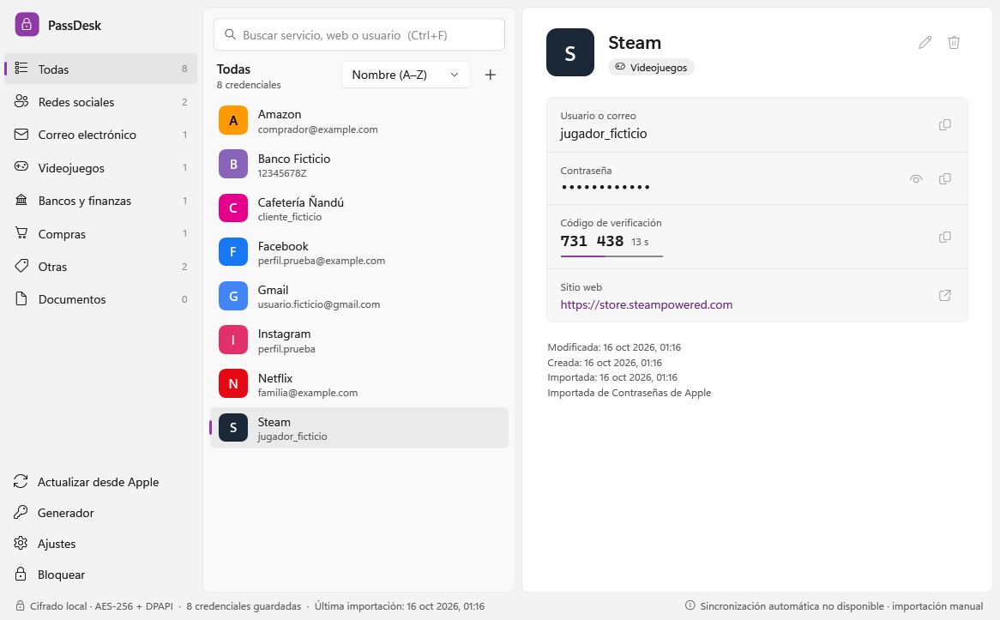
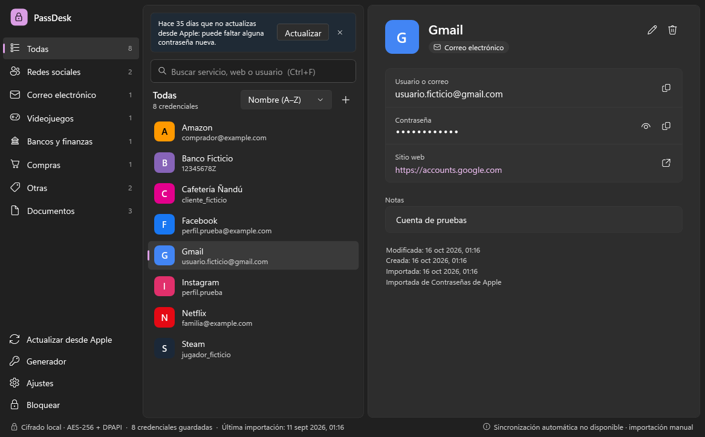
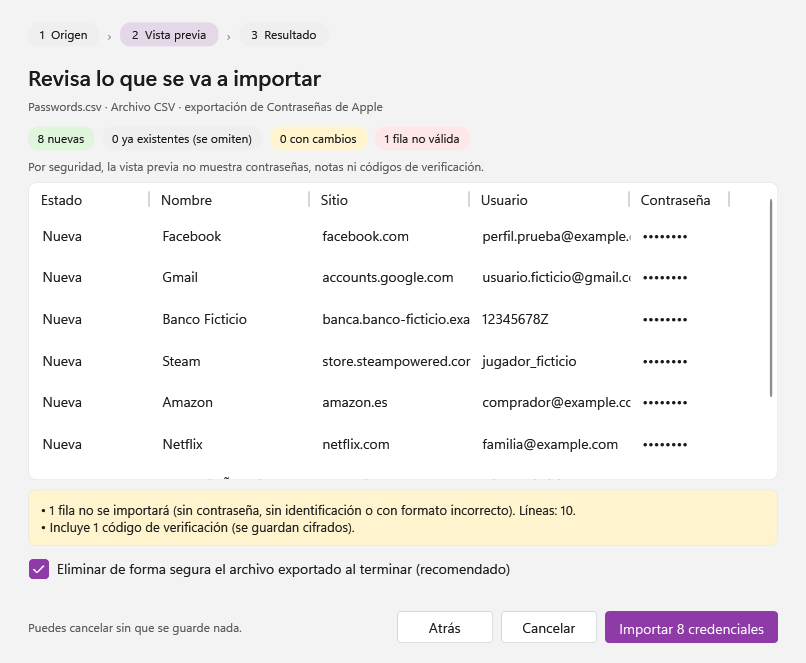
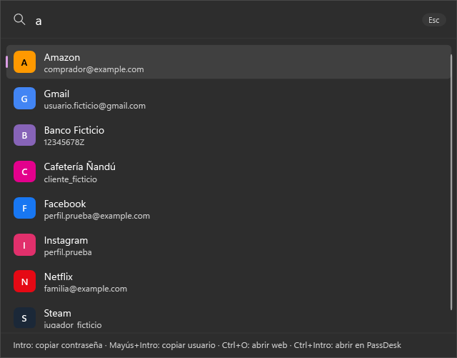
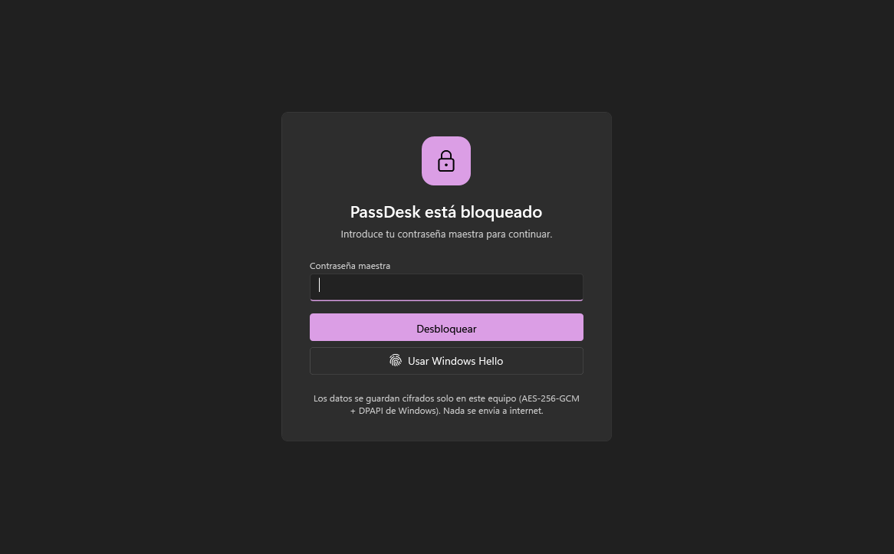
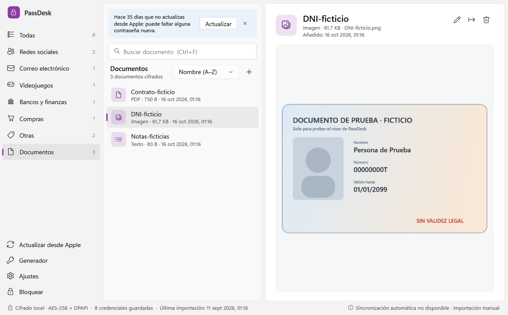
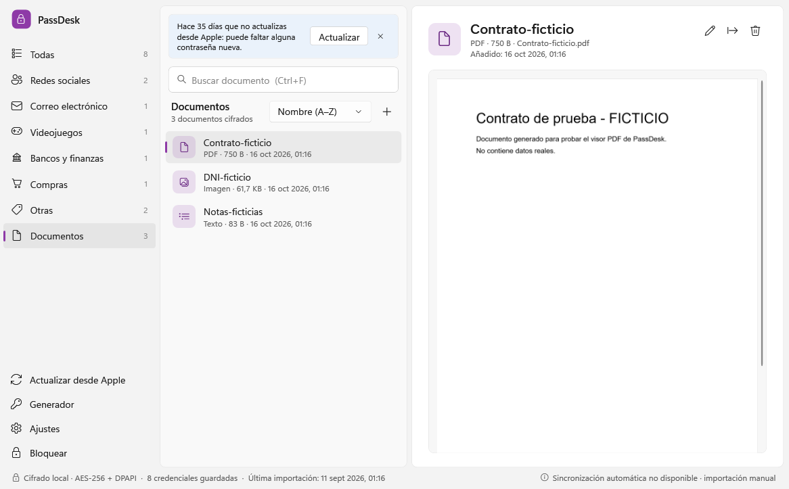

# PassDesk · tus contraseñas de Apple en Windows 11

Aplicación de escritorio para Windows 11 que permite **consultar, buscar y copiar** las contraseñas guardadas en
**Contraseñas de Apple** sin coger el iPhone ni abrir hojas de cálculo, y guardar también **documentos del iPhone**
(DNI, pasaporte, PDF, fotos) para consultarlos desde el PC. Todo se guarda **cifrado solo en este equipo**
(AES‑256‑GCM + DPAPI de Windows) y nada se envía a internet.

> PassDesk es un proyecto personal. **No está afiliado a Apple Inc.** ni usa servicios de Apple.

| Tema claro | Tema oscuro |
|---|---|
|  |  |

*(Capturas generadas con datos ficticios; la app usa el color de énfasis de tu Windows.)*

---

## 1. Integración con Apple: qué es posible y qué no

Antes de programar se verificaron las opciones oficiales (octubre de 2026):

| Opción | Resultado | Detalle |
|---|---|---|
| **A. iCloud para Windows** | ❌ Sin integración directa posible | La app oficial **Contraseñas de iCloud** (incluida en iCloud para Windows, Microsoft Store) sincroniza con el iPhone, pero Apple **no publica ninguna API** para que otras aplicaciones lean esas contraseñas. Leer sus archivos internos o su protocolo privado con la extensión del navegador sería ingeniería inversa no admitida, así que no se hace. |
| **B. Importación segura** | ✅ **Implementada** | Apple permite **exportar** las contraseñas a un archivo CSV: desde *Contraseñas de iCloud* en Windows (Exportar contraseñas), desde el iPhone/iPad con iOS 18.2+ (Ajustes › Apps › Safari › Exportar, que genera un ZIP) y desde la app Contraseñas del Mac. PassDesk importa ese archivo (CSV o el ZIP directamente). |
| **C. Sincronización futura** | 🧩 Preparada | La importación está detrás de la interfaz `ICredentialSource`. Hay registrada una fuente «Sincronización directa con iCloud» que informa de que **no está disponible**; si Apple publicara un mecanismo oficial, bastaría con implementar esa interfaz. |

**Conclusión honesta:** no existe sincronización automática con el iPhone. PassDesk funciona con importaciones
manuales; volver a importar más adelante detecta automáticamente las cuentas nuevas, las repetidas y las que han
cambiado. Si solo quieres *ver* tus contraseñas en el PC con sincronización en vivo, la app oficial *Contraseñas de
iCloud* para Windows también lo permite; PassDesk aporta búsqueda instantánea, categorías, búsqueda rápida global,
generador y una copia local cifrada que funciona sin conexión.

Fuentes: [Exportar contraseñas de iCloud en Windows](https://support.apple.com/guide/icloud-windows/icw3cb8e8853/icloud) ·
[Importar en Contraseñas de iCloud (Windows)](https://support.apple.com/guide/icloud-windows/icwdd81d02c4/icloud) ·
[Exportar contraseñas en iPad (iPadOS 18.2+)](https://support.apple.com/en-lamr/guide/ipad/ipad6a95d64f/ipados) ·
[Exportar desde la app Contraseñas del Mac](https://support.apple.com/guide/passwords/mchl35b12625/mac) ·
[iCloud en Microsoft Store](https://apps.microsoft.com/detail/9pktq5699m62)

---

## 2. Funciones

- **Panel principal:** todas las cuentas, buscador instantáneo (servicio, dominio, URL, usuario o correo; sin
  distinguir mayúsculas ni tildes), categorías (redes sociales, correo, videojuegos, bancos, compras, otras) con
  recuento, orden por nombre o por fecha de modificación, total de credenciales y **fecha de la última importación**.
- **Detalle:** servicio, web (se abre en el navegador; solo enlaces http/https), usuario, contraseña **oculta por
  defecto** (se revela con un botón y se vuelve a ocultar a los 30 s o al cambiar de ventana), notas, **códigos de
  verificación (TOTP)** importados de Apple con cuenta atrás, y fechas.
- **Copiar con un clic** usuario, contraseña o código, con **borrado automático del portapapeles**.
- **Búsqueda rápida global:** atajo configurable (por defecto `Ctrl + Mayús + Espacio`) que abre una ventana compacta:
  escribe, `Intro` copia la contraseña, `Mayús+Intro` el usuario, `Ctrl+O` abre la web, `Ctrl+Intro` la abre en PassDesk.
- **Icono en la bandeja del sistema:** al cerrar la ventana (o, si lo eliges, al minimizarla), PassDesk sigue junto al
  reloj para que la búsqueda rápida funcione sin la ventana abierta. Menú: *Abrir* (también con doble clic), *Bloquear
  ahora*, *Búsqueda rápida* y *Salir*. El icono y su menú nunca muestran datos de tus cuentas.
- **Iniciar con Windows** (opcional, desactivado por defecto): al iniciar sesión, PassDesk se abre en la bandeja, sin
  ventana y bloqueado.
- **Generador** de contraseñas criptográficamente seguro (longitud, mayúsculas, números, símbolos, evitar caracteres
  confusos).
- **Actualización casi automática:** PassDesk detecta las exportaciones de Apple que guardes en Escritorio, Descargas o
  Documentos, abre la vista previa con solo lo nuevo y lo cambiado, y borra el archivo al terminar. Si pasan 30 días
  sin actualizar, te lo recuerda.
- **Gestión local:** añadir, editar y eliminar (solo afecta a la copia de PassDesk; nunca a Apple).
- **Documentos cifrados:** guarda archivos del iPhone (fotos del DNI o del pasaporte, PDF, notas de texto) dentro de
  PassDesk y míralos sin salir de la app: imágenes (con la orientación correcta de las fotos del iPhone), PDF (hasta
  20 páginas en la vista previa) y texto. Se pueden buscar, renombrar, exportar y eliminar. Máximo 50 MB por archivo.
- **Copias de seguridad cifradas** (`.pdbackup`, incluyen los documentos) para cambiar de equipo, **puntos de
  recuperación automáticos** antes de cada importación o restauración, y **cambio de contraseña maestra**.
- **Modo claro/oscuro** (o según Windows), diseño Fluent de Windows 11 y adaptación a ventanas estrechas.

### Atajos de teclado

| Atajo | Acción |
|---|---|
| `Ctrl+F` | Buscar |
| `Ctrl+Mayús+C` (o `Ctrl+C`/`Intro` en la lista) | Copiar contraseña |
| `Ctrl+B` | Copiar usuario |
| `Ctrl+H` | Mostrar/ocultar contraseña |
| `Ctrl+U` | Abrir la web |
| `Ctrl+N` / `Ctrl+E` / `Supr` | Nueva / editar / eliminar |
| `Ctrl+I` | Importar desde Apple |
| `Ctrl+G` | Generador |
| `Ctrl+L` | **Bloquear ahora** |
| `Ctrl+Mayús+Espacio` | Búsqueda rápida global (configurable) |

---

## 3. Seguridad (resumen)

Detalle completo en [docs/SEGURIDAD.md](docs/SEGURIDAD.md).

- **Cifrado en reposo:** AES‑256‑GCM con una clave de datos aleatoria, protegida por una clave derivada de tu
  contraseña maestra con **Argon2id** (64 MiB de memoria, 3 pasadas; calculado con libsodium). Las bóvedas creadas con
  versiones anteriores (PBKDF2‑HMAC‑SHA256, 600.000 iteraciones) se pasan a Argon2id solas la primera vez que las
  desbloqueas; si no se puede (por ejemplo, porque un antivirus bloquea libsodium), se abren igual y se reintenta más
  tarde. Encima, una capa **DPAPI** vinculada a tu usuario de Windows. Solo primitivas estándar; ningún algoritmo
  propio.
- **Contraseña maestra:** mínimo 12 caracteres y fortaleza estimada «Fuerte» (por ejemplo, una frase de 4 palabras con
  algún número o símbolo). Si la tuya es de una versión anterior y no llega a ese nivel, PassDesk te avisa antes de
  exportar una copia de seguridad. Al cambiarla, te recuerda que las copias anteriores se siguen abriendo con la
  antigua y ofrece borrar los puntos de recuperación; las copias `.pdbackup` exportadas tienes que borrarlas tú.
- **Nada en texto plano** en disco: ni en la bóveda, ni en ajustes, cachés o registros. Las contraseñas también se
  mantienen cifradas en memoria (`CryptProtectMemory`) y solo se descifran al mostrarlas o copiarlas.
- **Documentos:** cada archivo se cifra con su propia clave AES‑256‑GCM, guardada dentro de la bóveda; en disco solo hay
  archivos con nombres aleatorios. El visor descifra en memoria y nunca crea copias temporales; solo *Exportar* (con
  aviso) deja un archivo sin cifrar.
- **Autenticación** al abrir la app y al desbloquear. **Bloqueo automático** por inactividad (configurable), al bloquear
  Windows (`Win+L`), al suspender, opcionalmente al minimizar o pasar a la bandeja, y manual (`Ctrl+L`). Intentos
  fallidos con esperas crecientes que persisten tras reiniciar (el contador va cifrado y, si se daña, se aplica la espera
  máxima).
- **Bandeja del sistema:** cerrar la ventana la deja en la bandeja y cuenta como minimizarla, así que **ya no bloquea al
  instante**: se aplican el bloqueo por inactividad y, si la activas, la opción «Bloquear al minimizar la ventana o
  pasarla a la bandeja». *Salir* (menú del icono) bloquea, limpia el portapapeles y cierra, como antes al cerrar.
- **Windows Hello** (rostro, huella o PIN), **desactivado por defecto**: si lo activas, sirve para volver a
  desbloquear durante 8 horas desde la última vez que escribiste la contraseña maestra, y nunca después de bloquear
  Windows, suspender el equipo o reiniciar PassDesk. Ten en cuenta que, en ese tiempo, quien conozca el PIN de Windows
  puede abrir PassDesk.
- **Portapapeles:** se excluye del historial (`Win+V`) y de la sincronización en la nube, y se borra a los N segundos
  **solo si sigue conteniendo lo que copió PassDesk**. Si otra aplicación lo tiene ocupado, lo reintenta (y de nuevo
  al bloquear y al salir). Copiar con `Ctrl+C` desde las notas, el editor, el generador o un documento de texto recibe
  la misma protección.
- **Guardado seguro:** si un guardado falla (disco lleno, antivirus…), los cambios se deshacen también en memoria; la
  bóveda nunca queda a medias.
- **Capturas y pantalla compartida:** la ventana se excluye de capturas, grabaciones y Teams/Zoom (opción activable).
- **Sin red ni telemetría:** la app no hace ninguna conexión (los iconos de servicio se generan localmente).
- **Registros sin secretos:** solo códigos de evento y contadores; verificado con pruebas automáticas.

---

## 4. Instalación

### Requisitos

- Windows 11 (o Windows 10 2004 o posterior), 64 bits.
- **Runtime de escritorio de .NET 10** (ya está instalado en este equipo). En otro PC: `winget install Microsoft.DotNet.DesktopRuntime.10`.
  Alternativa: publicar con `-Mode selfcontained`, que lo incluye.
- Para compilar: **SDK de .NET 10** (`winget install Microsoft.DotNet.SDK.10`). En este equipo se instaló de forma
  local en `%LOCALAPPDATA%\Microsoft\dotnet` y los scripts lo encuentran solos.

### Pasos (sin permisos de administrador)

```powershell
# 1) Compilar, ejecutar las pruebas y generar dist\PassDesk\PassDesk.exe
powershell -ExecutionPolicy Bypass -File scripts\publish.ps1

# 2) Instalar en %LOCALAPPDATA%\Programs\PassDesk con acceso directo en el menú Inicio
powershell -ExecutionPolicy Bypass -File scripts\install.ps1            # añade -DesktopShortcut si quieres icono en el escritorio

# Desinstalar (conserva tus datos cifrados salvo que añadas -RemoveData)
powershell -ExecutionPolicy Bypass -File scripts\uninstall.ps1
```

El programa se instala en `%LOCALAPPDATA%\Programs\PassDesk` y los datos cifrados viven aparte, en
`%LOCALAPPDATA%\PassDesk` (no se borran al actualizar o desinstalar). Antes de actualizar o desinstalar, cierra PassDesk
desde su icono de la bandeja (*Salir*): cerrar la ventana no basta. *Iniciar con Windows* solo se ofrece en esa copia
instalada; crea el valor `PassDesk` en `HKCU\Software\Microsoft\Windows\CurrentVersion\Run` (sin permisos de
administrador) y `uninstall.ps1` lo quita.

---

## 5. Uso

1. **Primera vez:** crea una contraseña maestra (mínimo 12 caracteres y fortaleza «Fuerte»; mejor una frase de 4 o más
   palabras). No se puede recuperar si la
   olvidas: tus contraseñas seguirán en el iPhone, pero tendrías que crear una bóveda nueva e importar de nuevo.
2. **Exporta desde Apple** (elige una opción):
   - **Recomendada — iCloud para Windows en este PC:** instala *iCloud* desde Microsoft Store, abre *Contraseñas de
     iCloud*, pulsa selección múltiple › *Seleccionar todo* › *Exportar contraseñas* y guarda el CSV en una carpeta local
     (no en OneDrive). Así el archivo no tiene que viajar desde el iPhone.
   - **iPhone (iOS 18.2+):** Ajustes › Apps › Safari › Exportar › deja solo *Contraseñas* › *Guardar en Descargas*.
     Pasa el ZIP al PC (por ejemplo, desde iCloud Drive).
   - **Mac:** app Contraseñas › Archivo › Exportar todas las contraseñas.
3. **Importa:** si guardas la exportación en Escritorio, Descargas o Documentos, PassDesk la detecta sola y abre la
   **vista previa sin contraseñas** (nuevas, repetidas, con cambios y filas no válidas). También puedes usar
   `Actualizar desde Apple` o arrastrar el archivo a la ventana. Confirma, y PassDesk cifrará y guardará los datos.
   Con las cuentas que han cambiado, la opción recomendada **actualiza solo las que no has modificado en PassDesk**;
   si cambiaste una a mano, conserva las dos versiones. La vista previa indica cuántas se actualizan, cuántas se añaden
   y cuántas se quedan como están. Antes de aplicar nada se guarda un **punto de recuperación**.
4. **La exportación se borra sola** al terminar (sobrescrita con datos aleatorios, sin Papelera), salvo que desmarques
   esa casilla. Solo se borra si **todo** lo que traía quedó guardado (sin filas no válidas ni cambios descartados) y si
   el archivo sigue siendo **exactamente** el que se leyó (mismo tamaño y SHA‑256); si no, PassDesk te lo explica y lo
   deja. Bórrala también del iPhone (Archivos › Descargas) y de *Eliminados recientemente* si la creaste allí.

### Mantener PassDesk al día con el iPhone

Apple no permite que ninguna app lea tus contraseñas, así que la actualización no puede ser automática del todo. Lo más
rápido (unos 30 segundos) es repetir la exportación cuando hayas guardado contraseñas nuevas:

1. En el iPhone: Ajustes › Apps › Safari › Exportar › solo *Contraseñas* › *Guardar en Descargas*.
2. Pásala al PC **sin usar la nube**. La opción más cómoda es [LocalSend](https://localsend.org/) (gratuita, de código
   abierto, sin cuenta), que envía el archivo por tu Wi‑Fi con HTTPS y lo deja en **Descargas**. En Windows, la red Wi‑Fi
   debe estar como *privada* para que el PC aparezca, y en el iPhone hay que permitir el acceso a la red local. También
   sirve un pendrive USB‑C o descargarla desde icloud.com › iCloud Drive › Descargas.
3. Abre PassDesk: verás directamente la vista previa con las cuentas nuevas y las cambiadas. Confirma y listo.

Si iCloud para Windows te funciona, también puedes exportar desde *Contraseñas de iCloud* en el propio PC (botón
*Abrir Contraseñas de iCloud* del asistente). Para ver al instante una contraseña recién creada en el iPhone, esa app
o la extensión oficial *Contraseñas de iCloud* para Edge/Chrome ya están sincronizadas en vivo.



| Búsqueda rápida | Bloqueo |
|---|---|
|  |  |

### Documentos del iPhone (DNI, pasaporte, PDF…)

1. Pasa los archivos al PC igual que la exportación de contraseñas: con **LocalSend** (en el iPhone: *Enviar* ›
   *Archivo*, o *Multimedia* para fotos, y elige el PC) llegan a **Descargas**; también sirve un pendrive USB‑C.
2. En PassDesk abre **Documentos** (barra lateral) y pulsa **+** (*Añadir documentos…*) o **arrastra** los archivos a
   la lista. Se cifran al momento.
3. PassDesk te ofrece **eliminar de forma segura los originales** que siguen sin cifrar en el PC. Bórralos también del
   iPhone si ya no los quieres allí.
4. Selecciona un documento para verlo. Usa **Exportar** solo si necesitas enviarlo o imprimirlo: el archivo exportado
   queda **sin cifrar** y conviene borrarlo después.

| Foto de un documento | PDF |
|---|---|
|  |  |

Formatos con vista previa: JPG, PNG, GIF, BMP, TIFF, WebP, HEIC (necesita la extensión gratuita *HEIF Image
Extensions* de Microsoft Store), PDF y texto (TXT, MD, CSV, JSON, XML). Los demás archivos se guardan igual de
cifrados y se abren exportándolos.

### Copias de seguridad y cambio de equipo

*Ajustes › Exportar copia cifrada* crea un archivo `.pdbackup` protegido con tu contraseña maestra actual (Argon2id,
sin DPAPI), que puedes guardar en un USB o en la nube. Incluye las contraseñas **y los documentos**. Como no tiene la
capa de Windows, quien la consiga puede intentar adivinar la contraseña maestra sin límite de intentos: usa una
contraseña maestra fuerte y guarda la copia en un sitio que solo controles tú. En otro equipo o usuario: instala
PassDesk, crea una bóveda y usa *Ajustes › Restaurar copia*. Al restaurar, la opción recomendada solo sustituye una
cuenta si la versión de la copia es **más reciente**. Más detalles sobre DPAPI en
[docs/SEGURIDAD.md](docs/SEGURIDAD.md#dpapi-cambios-de-usuario-migraciones-y-copias).

### Puntos de recuperación (deshacer una importación)

Antes de cada importación o restauración, PassDesk guarda una copia de la bóveda tal como estaba (igual de cifrada)
en `%LOCALAPPDATA%\PassDesk\recuperacion` y conserva las 10 más recientes. Para volver atrás: *Ajustes › Puntos de
recuperación…*, elige el anterior a la importación, escribe la contraseña maestra y, en la vista previa, marca
*Actualizar siempre con los datos importados*. Las cuentas que añadió la importación no se borran solas.

Cada punto (y cada copia `.pdbackup`) se abre con la contraseña maestra que había al guardarlo. Por eso, al cambiar la
contraseña maestra, PassDesk te lo explica y te pregunta si quieres borrar los puntos de recuperación anteriores al
cambio (por defecto, no); por la copia de antes de pasar a Argon2id (`vault-…-antesdeargon2id.pdv`) pregunta aparte.
Si la cambiaste porque otra persona la conoce, bórralos, y borra también a mano las copias `.pdbackup` antiguas (en el
PC, el USB o la nube) y exporta una nueva.

### Bandeja del sistema e inicio con Windows

Mientras PassDesk está abierto, su icono está junto al reloj. Windows 11 pone los iconos nuevos entre los ocultos (la
flecha `^`): para tenerlo siempre a la vista, arrástralo a la barra de tareas o actívalo en *Configuración ›
Personalización › Barra de tareas › Otros iconos de la bandeja del sistema*.

- **Doble clic** en el icono (o `Intro` con el icono seleccionado) abre la ventana; un solo clic no hace nada. **Clic
  derecho:** *Abrir*, *Bloquear ahora*, *Búsqueda rápida* y *Salir*.
- Por defecto, **cerrar la ventana** la deja en la bandeja; para salir del todo, *Salir*. En *Ajustes › Bandeja del
  sistema* puedes elegir que pase a la bandeja **al minimizar**: entonces cerrar la ventana sale de PassDesk, como antes.
- **Iniciar con Windows** (*Ajustes › Bandeja del sistema*, desactivado por defecto): al iniciar sesión, PassDesk se abre
  en la bandeja, sin ventana y bloqueado; la búsqueda rápida ya funciona y pide la contraseña maestra.

---

## 6. Arquitectura

```
PassDesk.slnx
├─ src/PassDesk.Crypto    Cifrado: AES-256-GCM, Argon2id (libsodium) y PBKDF2 heredado, DPAPI, documentos, secretos en memoria
├─ src/PassDesk.Core      Dominio: credenciales, documentos, búsqueda, categorías, generador, TOTP, portapapeles, registro sin secretos
├─ src/PassDesk.Storage   Almacenamiento: bóveda y documentos (DPAPI + escritura atómica), copias, ajustes, registro en disco
├─ src/PassDesk.Auth      Autenticación y servicios: sesión, bloqueo/desbloqueo, Windows Hello, intentos, inactividad, documentos
├─ src/PassDesk.Import    Importación: lector CSV/ZIP de Apple, detección de exportaciones, duplicados, borrado seguro
├─ src/PassDesk.App       Interfaz WPF (.NET 10, tema Fluent de Windows 11) y servicios de Windows
├─ tests/PassDesk.Tests   236 pruebas automáticas (xUnit) con datos ficticios
└─ tools/PassDesk.UiSnapshots  Herramienta de desarrollo: capturas de la interfaz con datos ficticios
```

**Por qué WPF sobre .NET 10:** aplicación de escritorio nativa que compila solo con el SDK (sin Visual Studio), usa el
runtime de escritorio ya presente en Windows, ofrece el tema Fluent de Windows 11 y acceso directo a DPAPI, Windows
Hello, `SetWindowDisplayAffinity` y atajos globales. WinUI 3 habría exigido Windows App SDK y empaquetado MSIX con más
complejidad y sin ventaja de seguridad. Una sola dependencia que no es de Microsoft:
[NSec](https://nsec.rocks/) (licencia MIT), el envoltorio para .NET de **libsodium**, la biblioteca criptográfica
auditada con la que se calcula Argon2id; xUnit solo en las pruebas.

---

## 7. Pruebas

```powershell
$env:DOTNET_ROOT="$env:LOCALAPPDATA\Microsoft\dotnet"
& "$env:DOTNET_ROOT\dotnet.exe" test tests\PassDesk.Tests\PassDesk.Tests.csproj
```

Cubren: cifrado/descifrado y manipulación (integridad GCM), contraseña incorrecta, DPAPI, bloqueo y desbloqueo,
limitación de intentos (también tras reiniciar), Windows Hello simulado, bloqueo automático por inactividad,
importación de archivos válidos e inválidos (CSV de Apple, iCloud/navegador, punto y coma, BOM, UTF‑16, Latin‑1,
comillas y saltos de línea, ZIP de Safari, ZIP dañado, binario), detección de duplicados y conflictos, búsqueda por
servicio/dominio/usuario, detección de exportaciones nuevas, clasificación, generador, TOTP (vectores del RFC 6238), portapapeles (borrado, no borrar
contenido ajeno), copias de seguridad (también las antiguas sin documentos), documentos (cifrado y manipulación,
almacén DPAPI, añadir/abrir/renombrar/exportar/eliminar, duplicados, límite de tamaño, bloqueo, restauración desde
copia), gestión de errores, ausencia de fuente de sincronización y **ausencia de contraseñas, usuarios, sitios y nombres
de documentos en los registros** (en memoria y en disco).

Tras la auditoría de seguridad del 16/10/2026 se añadieron pruebas de:
- Portapapeles ocupado: reintentos y borrado al bloquear o salir.
- Copia protegida desde cuadros de texto, con una prueba de control que demuestra que, sin la protección, WPF usaría el
  portapapeles normal.
- Argon2id: valor de referencia fijo, cabecera no rebajable, mejora de bóvedas antiguas al desbloquear y fallo en esa
  mejora, también si libsodium no carga (la bóveda se abre igual) o ante un error fatal (no queda nada descifrado en
  memoria).
- Política de contraseña maestra y aviso de contraseña antigua débil.
- Opción de conflictos que no pierde cambios locales y restauración de copias antiguas.
- Huella del archivo antes de borrarlo y bloqueo del borrado si quedaron filas sin importar.
- Puntos de recuperación.
- Marcha atrás de guardados fallidos (entradas, borrados, documentos e importaciones).
- Caducidad de Windows Hello y olvido de su clave tras bloquear Windows o suspender.
- Detección de exportaciones que solo decodifica la cabecera (UTF‑8 y UTF‑16 LE/BE), nunca las filas.
- Guardado sin copias de los secretos en el `ArrayPool` de .NET (con una prueba de control que demuestra que el texto
  JSON sí las dejaba) y lectura de bóvedas con el formato anterior.
- Cambio de contraseña maestra: el `.bak` deja de abrirse con la antigua, y si ese segundo guardado falla, el cambio no
  se pierde. Los puntos de recuperación anteriores solo abren con la antigua y se pueden borrar: se borran solo los
  indicados (nunca la bóveda ni archivos fuera de `recuperacion\`), se reconoce la copia previa a Argon2id y se informa
  de los que no se pueden borrar.
- Contador de intentos: cifrado con DPAPI, espera máxima si está dañado o tiene valores imposibles, sin desbordamiento
  y lectura del formato anterior. Una bóveda que este equipo no puede descifrar se avisa antes de cualquier espera, el
  contador vuelve a cero al crear una bóveda nueva y la cuenta atrás no dice «Contraseña incorrecta» si no se comprobó.

Para la bandeja del sistema e *Iniciar con Windows* (19/10/2026) se añadieron pruebas de:
- Qué hace cada opción del menú del icono (abrir, bloquear, búsqueda rápida, salir), su orden, *Abrir* como opción por
  defecto, *Bloquear ahora* desactivado con la bóveda bloqueada, y doble clic o `Intro` frente a un solo clic.
- Cerrar o minimizar según el ajuste, con «Bloquear al minimizar» aplicado al pasar a la bandeja, y salida normal tras
  *Salir* o si el icono no está.
- El texto y el menú del icono nunca contienen datos de la bóveda (bloqueada o desbloqueada).
- El ajuste nuevo (valor por defecto, guardado y valores imposibles) y el tamaño de la estructura de Windows del icono.
- La entrada de inicio con una clave del registro **en memoria** (las pruebas nunca escriben en el registro real):
  desactivada por defecto, ruta entre comillas con `--tray`, solo se borra la propia, solo se ofrece en la copia
  instalada con la carpeta de datos por defecto, y un rechazo del registro (antivirus, directiva) se informa sin guardar
  su mensaje en el registro de la app.

Además se probó la app real con un perfil ficticio mediante automatización de la interfaz: añadir documentos, verlos
(imagen, PDF y texto) y cerrar la aplicación. La bandeja, también con un perfil ficticio y sin teclado ni ratón (mensajes
de Windows al icono): cerrar la ventana la oculta y el doble clic la vuelve a abrir; el menú nativo muestra las cuatro
opciones con *Abrir* en negrita y *Bloquear ahora* desactivado; *Búsqueda rápida* y *Abrir* funcionan y *Salir* termina
con la salida normal; con `--tray` arranca sin ventana y con el atajo global registrado, y una segunda instancia con
`--tray` no muestra la ventana; en el modo «al minimizar», minimizar la oculta y cerrar sale. La escritura en el
registro real no se probó: por diseño, solo se prueba en memoria. Con el ejecutable publicado se comprobó crear una bóveda Argon2id,
reabrirla, y que una bóveda creada con la versión anterior (PBKDF2) se abre y pasa sola a Argon2id. Con un programa de
prueba al que se le quitó libsodium (datos ficticios) se comprobó que una bóveda PBKDF2 se abre sin convertirse y que
crear una bóveda, cambiar la contraseña o abrir una bóveda Argon2id devuelven el aviso de libsodium, sin contar como
intento fallido.

**Perfil de pruebas:** la variable `PASSDESK_DATA_DIR` hace que la app use otra carpeta de datos, para probarla con
datos ficticios sin tocar la bóveda real. Las capturas se regeneran con:
`tools\PassDesk.UiSnapshots\bin\Debug\...\PassDesk.UiSnapshots.exe <salida> <perfil-vacío> <csv-ficticio>`.

---

## 8. Limitaciones conocidas

- **Sin sincronización automática** con el iPhone (no hay API oficial). Los cambios hechos en PassDesk tampoco se
  envían a Apple.
- La exportación de Apple **no incluye** llaves de acceso (passkeys), contraseñas Wi‑Fi, contraseñas de grupos
  compartidos que no creaste ni cuentas de «Iniciar sesión con Apple».
- El desbloqueo con Windows Hello (desactivado por defecto) solo confirma tu presencia: no está ligado
  criptográficamente a la clave. Mientras dura (8 horas como máximo, sin bloquear Windows ni suspender), quien conozca
  el PIN de Windows puede abrir PassDesk.
- Una bóveda guardada con esta versión no se abre con versiones anteriores de PassDesk, que la dan por dañada (no lo
  está; no la archives): las anteriores a Argon2id no reconocen su clave, y las anteriores al contenido versión 2
  (secretos en Base64), su contenido. Instala la versión nueva antes de abrir con ella tu bóveda real y no vuelvas a una
  anterior: el `.bak` solo conserva la versión previa hasta el siguiente guardado.
- Para mostrar, editar o copiar una contraseña, .NET necesita una cadena en memoria que no se puede borrar; PassDesk
  minimiza su duración, pero la higiene de memoria es «mejor esfuerzo».
- El borrado seguro del archivo exportado no puede garantizarse en SSD, con instantáneas de volumen o en carpetas
  sincronizadas (OneDrive/iCloud Drive); la app lo advierte. Lo mismo vale para los originales de los documentos.
- Documentos: la vista previa de PDF muestra hasta 20 páginas y no abre PDF protegidos con contraseña (se pueden
  exportar). Las fotos HEIC necesitan la extensión *HEIF Image Extensions* de Microsoft Store. Mientras un documento
  está en pantalla, su imagen decodificada vive en memoria (se descarta al bloquear o cambiar de documento).
- Los documentos no se sincronizan con el iPhone: hay que añadirlos desde el PC.
- *Iniciar con Windows* solo se ofrece en la copia instalada en la carpeta por defecto
  (`%LOCALAPPDATA%\Programs\PassDesk`) y con la carpeta de datos por defecto (no con `PASSDESK_DATA_DIR`). Si lo
  desactivas en *Administrador de tareas › Aplicaciones de arranque*, manda Windows: no se abrirá aunque la casilla de
  PassDesk siga marcada.
- Con PassDesk en la bandeja, una exportación de Apple detectada no avisa (no hay botón en la barra de tareas que
  parpadee): la vista previa se abre al volver a la ventana.

Los cuatro puntos de riesgo bajo que la auditoría dejó pendientes ya están corregidos (ver
[docs/SEGURIDAD.md](docs/SEGURIDAD.md#corregido-tras-la-auditoría)). Sigue habiendo un límite: quien controle tu sesión
de Windows puede borrar el contador de intentos, aunque con ese acceso también podría copiar la bóveda y atacarla sin
conexión.

Posibles mejoras: instalador MSIX firmado y una fuente oficial de sincronización si Apple la publica (p. ej., el
estándar de intercambio de credenciales de FIDO, hoy solo disponible entre apps de iOS).
